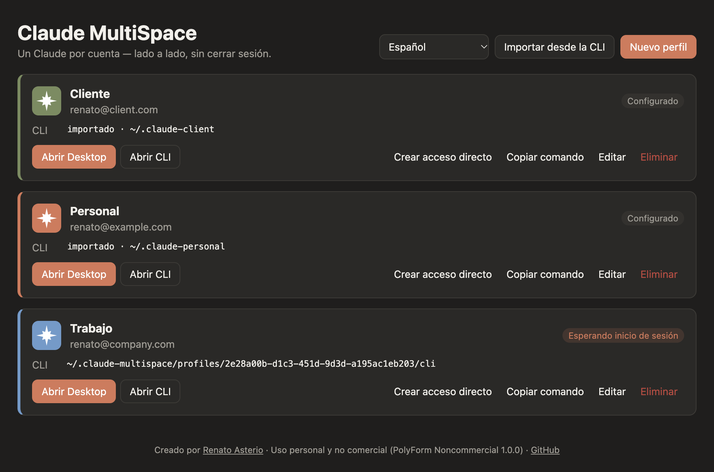
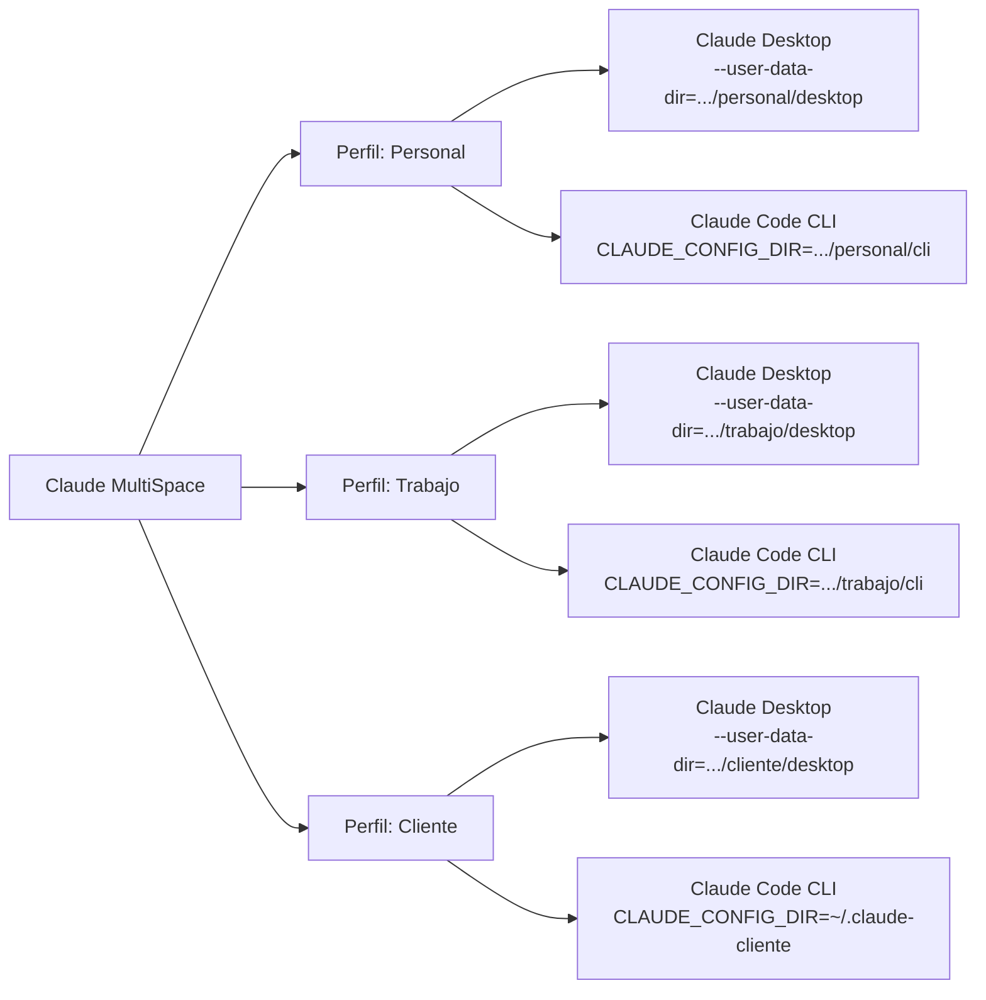
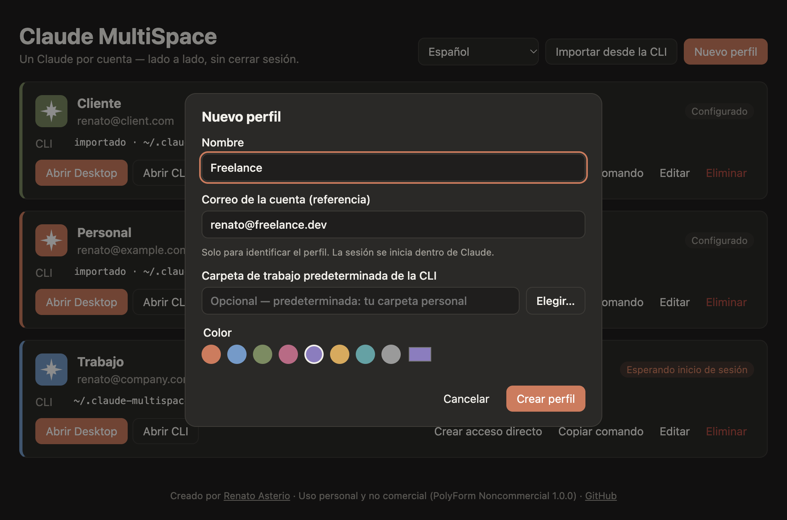
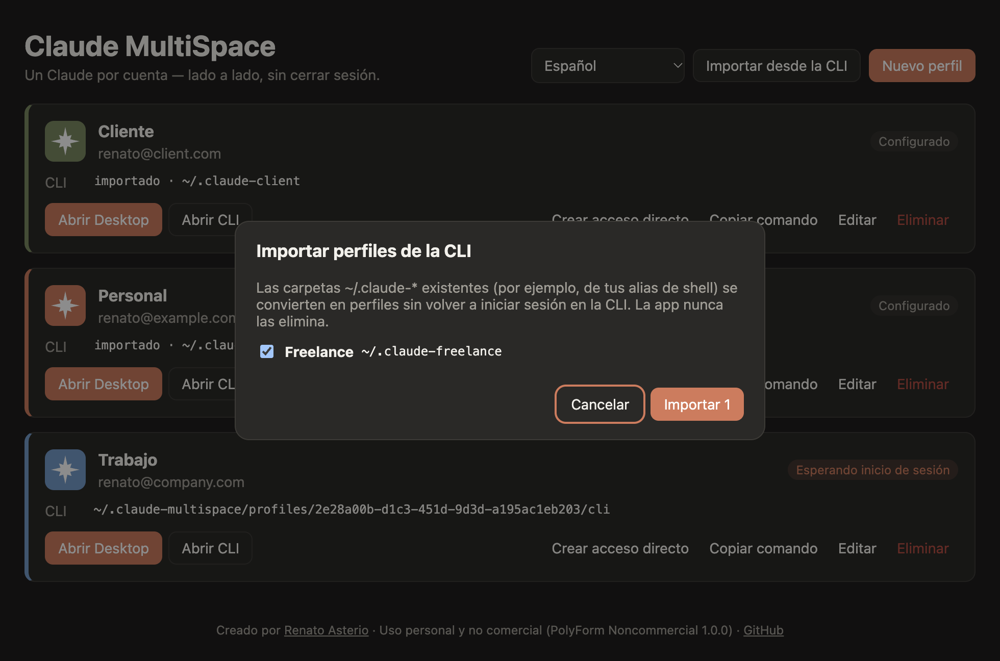

<div align="center">

# Claude MultiSpace

**Usa todas tus cuentas de Claude al mismo tiempo, lado a lado, sin cerrar sesión.**

Instancias aisladas de Claude Desktop y Claude Code CLI, una por cuenta, en macOS y Windows.

[English](README.md) · [Português (Brasil)](README.pt-BR.md) · **Español**

[](LICENSE.md)




</div>

---

## Contenido

- [El problema](#el-problema)
- [La solución](#la-solución)
- [Funcionalidades](#funcionalidades)
- [Cómo funciona](#cómo-funciona)
- [Requisitos](#requisitos)
- [Instalación](#instalación)
- [Primeros pasos](#primeros-pasos)
- [Guía de uso](#guía-de-uso)
- [Dónde se guardan tus datos](#dónde-se-guardan-tus-datos)
- [Preguntas frecuentes](#preguntas-frecuentes)
- [Solución de problemas](#solución-de-problemas)
- [Seguridad y privacidad](#seguridad-y-privacidad)
- [Para desarrolladores](#para-desarrolladores)
- [Licencia](#licencia)
- [Autor y créditos](#autor-y-créditos)

---

## El problema

Si trabajas con más de una cuenta de Claude (personal, de la empresa, de clientes, cada una con su propio plan), te encuentras con el mismo obstáculo todos los días:

- **Claude Desktop** mantiene la sesión iniciada en **una sola cuenta a la vez**. Para cambiar, tienes que cerrar sesión y volver a iniciarla.
- **Claude Code CLI** usa la misma configuración global (`~/.claude`) en todas las terminales, así que cambiar de cuenta también implica `/logout` y `/login`.
- No puedes tener **dos ventanas de Claude abiertas con cuentas distintas**, trabajando en proyectos diferentes al mismo tiempo.

Cada cambio interrumpe tu trabajo, corta la sesión en curso y te hace perder tiempo. Con tres cuentas, eso pasa varias veces al día.

## La solución

**Claude MultiSpace** es un gestor de perfiles. Cada perfil representa una cuenta y tiene su propio espacio aislado en el disco. Con un clic abre:

- **una nueva ventana de Claude Desktop** con la sesión de ese perfil, y
- **una terminal con Claude Code CLI** ya configurada para ese perfil.

Inicias sesión **una sola vez por perfil**. A partir de ahí, cada cuenta se abre con la sesión ya iniciada, y todas pueden estar abiertas al mismo tiempo.

<div align="center">

| Antes                                        | Con Claude MultiSpace                                          |
| -------------------------------------------- | -------------------------------------------------------------- |
| Una sola cuenta con sesión iniciada a la vez | Todas las cuentas abiertas en paralelo                         |
| Cerrar e iniciar sesión en cada cambio       | Iniciar sesión una vez por perfil, para siempre                |
| `~/.claude` compartido entre proyectos       | Configuración, servidores MCP e historial separados por cuenta |
| Alias escritos a mano en `.zshrc`            | Una app visual que importa tus alias existentes                |

</div>

## Funcionalidades

- **Perfiles ilimitados**, cada uno con nombre, color, correo de referencia y carpeta de trabajo predeterminada.
- **Claude Desktop aislado por perfil**: varias ventanas lado a lado, cada una con su propia cuenta.
- **Claude Code CLI aislado por perfil**: abre una terminal con el `CLAUDE_CONFIG_DIR` correcto.
- **Pestaña Code del Desktop alineada con la CLI**: el Desktop de cada perfil usa la configuración de la CLI de ese perfil.
- **Importa tus alias**: las carpetas `~/.claude-*` existentes se convierten en perfiles sin volver a iniciar sesión.
- **Copiar comando**: genera una función `claude-<perfil>` para tu `~/.zshrc` o tu `$PROFILE` de PowerShell.
- **Una ventana por perfil**: abrir un perfil que ya está abierto trae su ventana al frente en lugar de iniciar una segunda copia (dos copias en el mismo perfil podrían dañar la sesión).
- **Iconos de colores**: cada perfil tiene su propio icono en su color, en las tarjetas, en el menú de la barra de menús/bandeja y en su acceso directo.
- **Accesos directos por perfil**: una app en el Launchpad/Dock (macOS) o una entrada en el menú Inicio (Windows), con el icono del perfil, que abre directamente el Claude Desktop de ese perfil.
- **Estado en tiempo real**: muestra si el Desktop de cada perfil está abierto, configurado o esperando inicio de sesión.
- **Icono en la barra de menús / bandeja del sistema** con atajos para abrir cualquier perfil.
- **Inglés, portugués (Brasil) y español**, a elegir dentro de la app. En el primer inicio, la app sigue el idioma del sistema.
- **macOS y Windows**, con tema claro y oscuro automático.
- **Privacidad**: la app nunca lee, copia ni envía credenciales. La sesión se inicia dentro del propio Claude.

## Cómo funciona

Claude MultiSpace no modifica Claude. Se basa en dos opciones de aislamiento que el propio Claude admite:



| App             | Mecanismo                                                  | Qué queda separado                                                          |
| --------------- | ---------------------------------------------------------- | --------------------------------------------------------------------------- |
| Claude Desktop  | Una nueva instancia con `--user-data-dir=<perfil>/desktop` | Sesión, cookies, `claude_desktop_config.json`, servidores MCP, preferencias |
| Claude Code CLI | La variable `CLAUDE_CONFIG_DIR=<perfil>/cli`               | Inicio de sesión, ajustes, historial, agentes y comandos                    |

Como cada perfil tiene su propia carpeta, las instancias nunca compiten por la misma sesión y pueden ejecutarse al mismo tiempo.

## Requisitos

|                 | macOS                                           | Windows                                                                         |
| --------------- | ----------------------------------------------- | ------------------------------------------------------------------------------- |
| Sistema         | macOS 12 o posterior (Intel o Apple Silicon)    | Windows 10 u 11 (x64 o ARM64)                                                   |
| Claude Desktop  | Instalado en `/Applications` o `~/Applications` | Instalado con el instalador de [claude.ai/download](https://claude.ai/download) |
| Claude Code CLI | Opcional, necesario para **Abrir CLI**          | Opcional, necesario para **Abrir CLI**                                          |
| Terminal        | Terminal.app (incluida)                         | Windows Terminal (recomendado) o Símbolo del sistema                            |

Para instalar Claude Code CLI:

```bash
curl -fsSL https://claude.ai/install.sh | bash
```

## Instalación

### Opción 1: instalador

1. Ve a la página de [Releases](https://github.com/renatoasterio/claude-multi-space/releases).
2. Descarga el archivo de tu sistema:
   - **macOS**: `Claude-MultiSpace-<versión>-universal.dmg`
   - **Windows**: `Claude-MultiSpace-Setup-<versión>.exe`
3. Instálalo como de costumbre.

> **Primer inicio.** Los instaladores todavía no están firmados, así que el sistema muestra una advertencia:
>
> - **macOS**: haz clic derecho en la app, elige **Abrir** y confirma.
> - **Windows**: en la ventana de SmartScreen, haz clic en **Más información** y luego en **Ejecutar de todas formas**.

### Opción 2: desde el código fuente

Ejecutar la app desde el código fuente requiere [Node.js](https://nodejs.org) 20.19 o posterior. **Generar los instaladores requiere Node.js 22.12 o posterior**: el repositorio incluye un `.nvmrc`, así que con [nvm](https://github.com/nvm-sh/nvm) basta con ejecutar `nvm use` antes.

```bash
git clone https://github.com/renatoasterio/claude-multi-space.git
```

```bash
cd claude-multi-space
```

```bash
npm install
```

```bash
npm run dev
```

Para generar tu propio instalador (Node.js 22.12+):

```bash
nvm use
```

```bash
npm run dist:mac
```

```bash
npm run dist:win
```

El instalador se genera en la carpeta `dist/`. Genera el instalador de Windows en un equipo con Windows.

## Primeros pasos

### 1. Crea un perfil por cuenta

Haz clic en **Nuevo perfil**, ponle un nombre (por ejemplo _Personal_, _Trabajo_ o _Cliente X_), elige un color y, si quieres, el correo de la cuenta y una carpeta de trabajo predeterminada.

<div align="center">

</div>

> El correo solo sirve para identificar el perfil. El inicio de sesión real ocurre dentro de Claude.

### 2. Inicia sesión en el Claude Desktop del perfil

Haz clic en **Abrir Desktop**. Se abre una nueva ventana de Claude Desktop en la pantalla de inicio de sesión. Entra con la cuenta que corresponde a ese perfil.

Listo: la próxima vez, esa ventana se abrirá con la sesión ya iniciada. Repite el proceso con cada perfil y todas las cuentas podrán estar abiertas al mismo tiempo.

### 3. Inicia sesión en el Claude Code CLI del perfil

Haz clic en **Abrir CLI**. Se abre una terminal en la carpeta de trabajo del perfil, ya ejecutando `claude`. La primera vez, escribe `/login` y entra con la misma cuenta.

### ¿Ya usas alias con `CLAUDE_CONFIG_DIR`?

Si tu `~/.zshrc` tiene algo así:

```bash
alias claude-cliente='CLAUDE_CONFIG_DIR=~/.claude-cliente claude'
```

haz clic en **Importar desde la CLI**. La app encuentra tus carpetas `~/.claude-*` existentes y convierte cada una en un perfil, **sin volver a iniciar sesión en la CLI**.

<div align="center">

</div>

## Guía de uso

### Acciones de cada perfil

| Acción                   | Qué hace                                                                                                                                                                                |
| ------------------------ | --------------------------------------------------------------------------------------------------------------------------------------------------------------------------------------- |
| **Abrir Desktop**        | Abre la instancia de Claude Desktop del perfil. Si ya está abierta, el botón pasa a **Mostrar Desktop** y trae la ventana existente al frente: nunca hay más de una ventana por perfil. |
| **Abrir CLI**            | Abre una terminal en la carpeta de trabajo del perfil ejecutando `claude`. Al salir de `claude`, la terminal mantiene el perfil activo.                                                 |
| **Crear acceso directo** | Crea un acceso directo con el icono y el color del perfil (ver más abajo). Una vez creado, el botón pasa a **Actualizar acceso directo**.                                               |
| **Copiar comando**       | Copia una función de shell para usar el perfil en cualquier terminal (ver más abajo).                                                                                                   |
| **Editar**               | Cambia el nombre, el color, el correo y la carpeta de trabajo. Los datos de sesión no se ven afectados.                                                                                 |
| **Eliminar**             | Quita el perfil y, si lo eliges, también su sesión y sus datos.                                                                                                                         |

### Estado de los perfiles

| Estado                         | Significado                                                                     |
| ------------------------------ | ------------------------------------------------------------------------------- |
| **Esperando inicio de sesión** | El perfil todavía no se ha usado. Abre el Desktop o la CLI para iniciar sesión. |
| **Configurado**                | El perfil ya tiene datos de sesión guardados.                                   |
| **Desktop abierto**            | El Claude Desktop de este perfil se está ejecutando ahora mismo.                |

### Usa un perfil desde cualquier terminal

**Copiar comando** genera una función lista para usar. En macOS (zsh o bash):

```bash
claude-trabajo() { CLAUDE_CONFIG_DIR='/Users/tu/.claude-multispace/profiles/<id>/cli' '/Users/tu/.local/bin/claude' "$@"; }
```

Pégala en tu `~/.zshrc`, abre una nueva terminal y ejecuta `claude-trabajo` desde cualquier carpeta. En Windows, el comando es una función de PowerShell para tu `$PROFILE`.

### Idioma

Usa el selector de idioma en la parte superior de la ventana para cambiar entre **English**, **Português (Brasil)** y **Español**. La elección se aplica al instante a la ventana, al menú de la barra de menús/bandeja y a los mensajes de error, y se recuerda para la próxima vez. En el primer inicio, la app sigue el idioma del sistema.

### Accesos directos con el color del perfil

**Crear acceso directo** genera una pequeña app con el icono y el color del perfil que abre directamente el Claude Desktop de ese perfil, sin abrir antes la ventana de Claude MultiSpace:

- **macOS**: el acceso directo se crea en `~/Applications/Claude MultiSpace` y se muestra en el Finder. También aparece en el Launchpad y en Spotlight; arrástralo al Dock para tenerlo siempre a mano.
- **Windows**: el acceso directo se crea en el menú Inicio, en **Claude MultiSpace**. Haz clic derecho para anclarlo a la barra de tareas o a Inicio.

Los accesos directos siguen la misma regla de una ventana por perfil: si ese perfil ya está abierto, su ventana se trae al frente. Cambiar el nombre o el color del perfil actualiza el acceso directo, y eliminar el perfil lo quita.

> El icono que se ve en el Dock o en la barra de tareas **mientras Claude Desktop está abierto** pertenece a la app de Anthropic y otros programas no pueden cambiarlo. El color del perfil aparece en el acceso directo que usas para abrirlo, en la app y en la barra de menús/bandeja.

### Barra de menús y bandeja del sistema

El icono de Claude MultiSpace en la barra de menús (macOS) o en la bandeja del sistema (Windows) muestra todos los perfiles con su icono de color y atajos para abrir su Desktop o su CLI. Los perfiles con el Desktop abierto aparecen marcados con `●`.

Cerrar la ventana principal solo la oculta. Para salir de la app, usa **Salir** en el menú del icono o `⌘Q`.

### Eliminar un perfil

Al eliminar, eliges si también quieres borrar la sesión y los datos del perfil. Por seguridad:

- No se pueden borrar los datos de un perfil con su Claude Desktop abierto. Cierra esa ventana primero.
- Las carpetas importadas (como `~/.claude-cliente`) **nunca** se borran. Solo el perfil sale de la lista.

## Dónde se guardan tus datos

Todo se queda en tu equipo, en carpetas a las que solo tu usuario puede acceder (permisos `0700`):

```text
~/.claude-multispace/
├── profiles.json            # nombres, colores y rutas de los perfiles (sin credenciales)
├── settings.json            # preferencias de la app (idioma)
├── shortcuts.json           # dónde se creó el acceso directo de cada perfil
├── icons/                   # iconos de los accesos directos (Windows)
├── scripts/                 # scripts usados para abrir la CLI en una terminal
└── profiles/
    └── <id-del-perfil>/
        ├── desktop/         # datos del Claude Desktop de este perfil
        └── cli/             # CLAUDE_CONFIG_DIR del Claude Code de este perfil
```

En Windows, `~` equivale a `C:\Users\<tu-usuario>`.

Para hacer una copia de seguridad de todos los perfiles, copia la carpeta `~/.claude-multispace` con la app y Claude cerrados.

## Preguntas frecuentes

<details>
<summary><strong>¿Esto infringe los términos de uso de Claude?</strong></summary>

Claude MultiSpace solo organiza cuentas **que te pertenecen**, usando opciones de aislamiento que admiten el propio Claude Desktop (`--user-data-dir`) y Claude Code (`CLAUDE_CONFIG_DIR`). No modifica Claude, no evita límites de uso y no comparte cuentas. Sigue respetando los términos de uso de Anthropic en cada cuenta.
</details>

<details>
<summary><strong>¿La app puede ver mis contraseñas o tokens?</strong></summary>

No. La sesión se inicia dentro del propio Claude, y es Claude quien escribe los datos de sesión en las carpetas del perfil. Claude MultiSpace nunca lee, copia ni envía credenciales, y no realiza ninguna conexión de red.
</details>

<details>
<summary><strong>¿Afecta a mi instalación normal de Claude?</strong></summary>

No. La instancia predeterminada de Claude Desktop y `~/.claude` siguen funcionando como antes, y pueden ejecutarse junto a los perfiles.
</details>

<details>
<summary><strong>¿Mis servidores MCP y ajustes aparecen en todos los perfiles?</strong></summary>

No. Cada perfil es independiente y empieza con los ajustes predeterminados de Claude. Configura los servidores MCP dentro de cada perfil, o copia tu `claude_desktop_config.json` a la carpeta `desktop` del perfil.
</details>

<details>
<summary><strong>¿Puedo usar el mismo perfil en el Desktop y en la CLI?</strong></summary>

Sí, es la configuración recomendada. El Desktop de cada perfil recibe el `CLAUDE_CONFIG_DIR` de ese perfil, así que la pestaña Code del Desktop y la terminal comparten la misma configuración.
</details>

<details>
<summary><strong>¿Puedo abrir el mismo perfil dos veces?</strong></summary>

No, a propósito. Claude Desktop no se protege contra dos copias que usen la misma carpeta de perfil, lo que podría dañar la sesión. Claude MultiSpace revisa los procesos en ejecución y, si el perfil ya está abierto, trae su ventana al frente, ya sea desde el botón, el menú de la bandeja o un acceso directo.
</details>

<details>
<summary><strong>¿Claude Desktop sigue recibiendo actualizaciones?</strong></summary>

Sí. Todas las instancias ejecutan el mismo Claude instalado. Cuando se actualiza, todos los perfiles pasan a usar la nueva versión.
</details>

## Solución de problemas

| Síntoma                                                               | Causa probable y solución                                                                                                                                                                                                             |
| --------------------------------------------------------------------- | ------------------------------------------------------------------------------------------------------------------------------------------------------------------------------------------------------------------------------------- |
| "No se encontró Claude Desktop"                                       | Claude no está en la ubicación predeterminada. En macOS, muévelo a `/Applications`. En Windows, instálalo con el instalador de [claude.ai/download](https://claude.ai/download) (la versión de Microsoft Store aún no es compatible). |
| "No se encontró Claude Code CLI"                                      | Instala la CLI con `curl -fsSL https://claude.ai/install.sh \| bash` y vuelve a abrir la app.                                                                                                                                         |
| **Mostrar Desktop** solo trae una ventana al frente                   | Ese perfil ya está abierto, y solo se permite una ventana por perfil. Es el comportamiento esperado.                                                                                                                                  |
| El estado no se actualiza                                             | El estado se actualiza cuando vuelves a la ventana de la app. Haz clic en ella para forzar la actualización.                                                                                                                          |
| "Cierra el Claude Desktop de este perfil antes de eliminar sus datos" | Cierra la ventana de Claude de ese perfil y vuelve a intentarlo.                                                                                                                                                                      |
| macOS dice que la app "no se puede abrir"                             | Haz clic derecho en la app, elige **Abrir** y confirma (el instalador todavía no está firmado).                                                                                                                                       |

## Seguridad y privacidad

- **Sin red**: la app no hace ninguna petición a internet ni recopila datos de uso.
- **Sin credenciales**: la app nunca lee, copia ni guarda tokens. Solo existen en los archivos que escribe Claude.
- **Interfaz aislada**: la interfaz se ejecuta en sandbox, sin acceso a Node.js, con una política de seguridad de contenido (CSP) estricta y la navegación bloqueada.
- **Comunicación validada**: cada llamada de la interfaz al proceso principal verifica su origen y valida sus datos.
- **Sin inyección de comandos**: los programas externos se ejecutan sin shell, y todos los valores usados en scripts pasan por funciones de escape probadas contra entradas maliciosas.
- **Borrado seguro**: la app solo borra archivos dentro de su propia carpeta y se niega a seguir enlaces simbólicos fuera de ella.
- **Binario reforzado**: la app empaquetada usa Electron Fuses para desactivar funciones de depuración y validar la integridad del código.

¿Encontraste una vulnerabilidad? Abre un [issue](https://github.com/renatoasterio/claude-multi-space/issues) sin detalles sensibles y pide un canal privado para el reporte.

## Para desarrolladores

### Scripts

| Comando                                 | Descripción                                               |
| --------------------------------------- | --------------------------------------------------------- |
| `npm run dev`                           | Inicia la app con recarga automática                      |
| `npm test`                              | Ejecuta las pruebas unitarias y de integración (Vitest)   |
| `npm run typecheck`                     | Verifica los tipos del proceso principal y de la interfaz |
| `npm run lint`                          | Ejecuta ESLint                                            |
| `npm run format`                        | Formatea el código con Prettier                           |
| `npm run build`                         | Build de producción en `out/`                             |
| `npm run dist:mac` / `npm run dist:win` | Genera los instaladores en `dist/`                        |

### Arquitectura

El proyecto sigue Clean Architecture: las dependencias siempre apuntan hacia el dominio, y ESLint impide que las capas internas importen Electron, Node.js o infraestructura.

```text
src/
├── shared/              # contratos IPC, esquemas zod, diccionarios de idioma y reglas compartidas
├── main/
│   ├── domain/          # entidad Profile, value objects y errores de dominio (claves de mensaje, sin texto)
│   ├── application/     # puertos (interfaces), servicios y casos de uso
│   ├── infrastructure/  # repositorios JSON, disco, launchers por sistema, detección de procesos
│   ├── mappers/         # entidad ⇄ registro persistido ⇄ DTO
│   ├── utils/           # spawn sin shell, escape de shell, cola serial, logger
│   ├── presentation/    # handlers IPC, ventana principal, icono de la bandeja
│   └── container.ts     # composition root (inyección de dependencias manual)
├── preload/             # puente mínimo y tipado entre la interfaz y el main
└── renderer/            # interfaz en React, organizada por feature
tests/
├── unit/                # dominio, casos de uso (con fakes), mappers, utils e i18n
└── integration/         # repositorios y workspace usando el sistema de archivos real
```

### Probar los accesos directos en desarrollo

En macOS, los accesos directos abren enlaces `claude-multispace://`, que el sistema solo entrega a la app empaquetada (el esquema está declarado en su `Info.plist`). Para probarlos, genera la app con `npm run dist:mac` y ejecútala desde `dist/`.

### Añadir un idioma

1. Copia `src/shared/i18n/messages/en.ts` a un archivo nuevo y traduce todos los valores. TypeScript impide el build si falta alguna clave.
2. Registra el idioma en `src/shared/i18n/locales.ts` y en el catálogo de `src/shared/i18n/translate.ts`.
3. Ejecuta `npm test`: las pruebas de i18n verifican que todos los idiomas tengan las mismas claves y los mismos parámetros.

### Stack

[Electron](https://www.electronjs.org) · [React](https://react.dev) · [TypeScript](https://www.typescriptlang.org) · [electron-vite](https://electron-vite.org) · [Zod](https://zod.dev) · [Vitest](https://vitest.dev) · [electron-builder](https://www.electron.build)

### Contribuir

Las contribuciones son bienvenidas, dentro de los términos de la [licencia](#licencia):

1. Haz un fork y crea una rama para tu cambio.
2. Ejecuta `npm run lint`, `npm run typecheck` y `npm test` antes de abrir un pull request.
3. Describe el problema que resuelves y cómo lo probaste, sobre todo si el cambio afecta a Windows.

## Licencia

Este proyecto es **gratuito y de código fuente disponible para uso personal y no comercial**, bajo la licencia [PolyForm Noncommercial 1.0.0](LICENSE.md).

| ✅ Permitido                                                 | ❌ No permitido                                                 |
| ------------------------------------------------------------ | --------------------------------------------------------------- |
| Uso personal, estudio, hobby e investigación                 | Vender el software o copias de él                               |
| Estudiar y modificar el código                               | Usarlo en productos, servicios o actividades con fines de lucro |
| Compartir copias y versiones modificadas, sin fines de lucro | Incluirlo en ofertas comerciales, de pago o patrocinadas        |
| Hacer forks, siempre que se dé crédito al autor              | Quitar o modificar los avisos de autoría                        |

Toda copia, fork u obra derivada debe conservar el archivo [LICENSE.md](LICENSE.md), incluidas las líneas `Required Notice` que dan crédito a **Renato Asterio**.

Para uso comercial, contacta con el autor.

## Autor y créditos

<div align="center">

Creado y mantenido por **[Renato Asterio](https://github.com/renatoasterio)**.

Si este proyecto te ayuda, considera darle una ⭐.

</div>

---

<sub>Claude MultiSpace es un proyecto independiente y no está afiliado, patrocinado ni respaldado por Anthropic. "Claude" y "Claude Code" son marcas de Anthropic, PBC.</sub>
