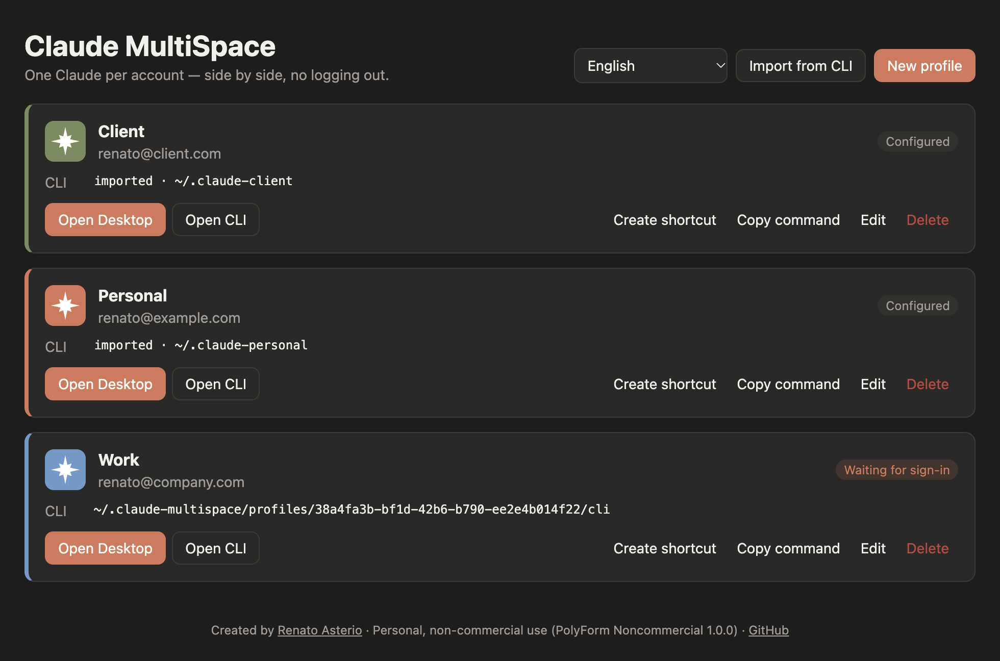
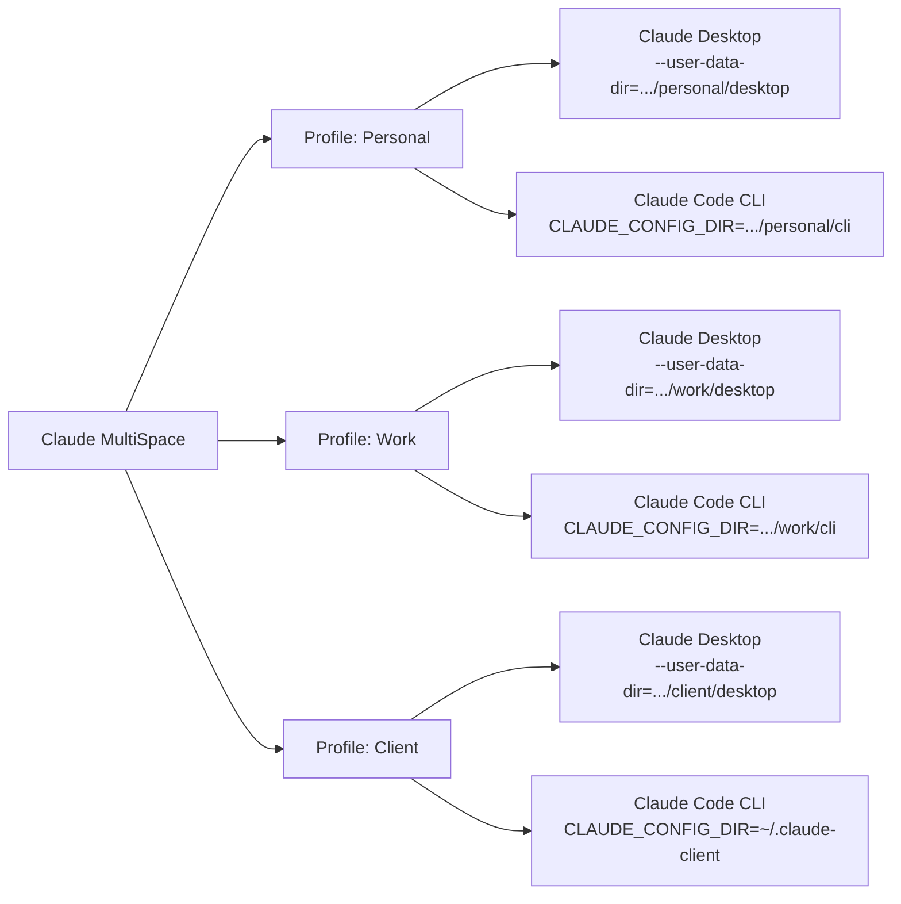
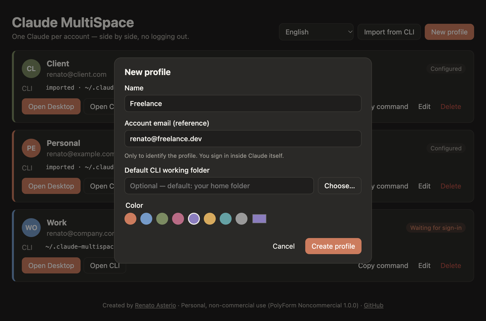
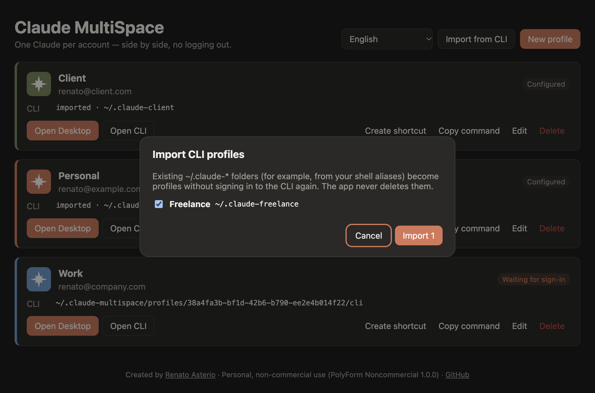

<div align="center">

# Claude MultiSpace

**Use all your Claude accounts at the same time, side by side, without logging out.**

Isolated Claude Desktop and Claude Code CLI instances, one per account, on macOS and Windows.

**English** · [Português (Brasil)](README.pt-BR.md)

[](LICENSE.md)




</div>

---

## Contents

- [The problem](#the-problem)
- [The solution](#the-solution)
- [Features](#features)
- [How it works](#how-it-works)
- [Requirements](#requirements)
- [Installation](#installation)
- [Getting started](#getting-started)
- [User guide](#user-guide)
- [Where your data lives](#where-your-data-lives)
- [FAQ](#faq)
- [Troubleshooting](#troubleshooting)
- [Security and privacy](#security-and-privacy)
- [For developers](#for-developers)
- [License](#license)
- [Author and credits](#author-and-credits)

---

## The problem

If you work with more than one Claude account (personal, company, clients, each on its own plan), you hit the same wall every day:

- **Claude Desktop** stays signed in to **one account at a time**. To switch, you sign out and sign in again.
- **Claude Code CLI** uses the same global configuration (`~/.claude`) for every terminal, so switching accounts also means `/logout` and `/login`.
- You can't keep **two Claude windows open on different accounts**, working on different projects at the same time.

Every switch interrupts your work, drops the running session and wastes time. With three accounts, that happens several times a day.

## The solution

**Claude MultiSpace** is a profile manager. Each profile represents one account and gets its own isolated space on disk. With one click it opens:

- **a new Claude Desktop window** with that profile's session, and
- **a terminal running Claude Code CLI** already configured for that profile.

You sign in **once per profile**. From then on, each account opens already signed in, and all of them can stay open at the same time.

<div align="center">

| Before                             | With Claude MultiSpace                                       |
| ---------------------------------- | ------------------------------------------------------------ |
| One account signed in at a time    | Every account open in parallel                               |
| Sign out and in on every switch    | Sign in once per profile, for good                           |
| `~/.claude` shared across projects | Configuration, MCP servers and history separated per account |
| Hand-written aliases in `.zshrc`   | A visual app that imports your existing aliases              |

</div>

## Features

- **Unlimited profiles**, each with a name, color, reference email and default working folder.
- **Isolated Claude Desktop per profile**: several windows side by side, each on its own account.
- **Isolated Claude Code CLI per profile**: opens a terminal with the right `CLAUDE_CONFIG_DIR`.
- **Desktop Code tab aligned with the CLI**: each profile's Desktop uses that profile's CLI configuration.
- **Imports your aliases**: existing `~/.claude-*` folders become profiles without signing in again.
- **Copy command**: generates a `claude-<profile>` function for your `~/.zshrc` or PowerShell `$PROFILE`.
- **Live status**: shows whether each profile's Desktop is open, configured or waiting for sign-in.
- **Menu bar / system tray icon** with shortcuts to open any profile.
- **English and Portuguese (Brazil)**, selectable inside the app. The first launch follows your system language.
- **macOS and Windows**, with automatic light and dark themes.
- **Privacy**: the app never reads, copies or sends credentials. You sign in inside Claude itself.

## How it works

Claude MultiSpace doesn't modify Claude. It relies on two isolation options supported by Claude itself:



| App             | Mechanism                                               | What stays separate                                                              |
| --------------- | ------------------------------------------------------- | -------------------------------------------------------------------------------- |
| Claude Desktop  | A new instance with `--user-data-dir=<profile>/desktop` | Sign-in session, cookies, `claude_desktop_config.json`, MCP servers, preferences |
| Claude Code CLI | The `CLAUDE_CONFIG_DIR=<profile>/cli` variable          | Sign-in, settings, history, agents and commands                                  |

Because every profile has its own folder, instances never fight over the same session and can run at the same time.

## Requirements

|                 | macOS                                            | Windows                                                                            |
| --------------- | ------------------------------------------------ | ---------------------------------------------------------------------------------- |
| System          | macOS 12 or later (Intel or Apple Silicon)       | Windows 10 or 11 (x64 or ARM64)                                                    |
| Claude Desktop  | Installed in `/Applications` or `~/Applications` | Installed with the installer from [claude.ai/download](https://claude.ai/download) |
| Claude Code CLI | Optional, needed for **Open CLI**                | Optional, needed for **Open CLI**                                                  |
| Terminal        | Terminal.app (built in)                          | Windows Terminal (recommended) or Command Prompt                                   |

To install Claude Code CLI:

```bash
curl -fsSL https://claude.ai/install.sh | bash
```

## Installation

### Option 1: installer

1. Go to the [Releases](https://github.com/renatoasterio/claude-multi-space/releases) page.
2. Download the file for your system:
   - **macOS**: `Claude-MultiSpace-<version>-universal.dmg`
   - **Windows**: `Claude-MultiSpace-Setup-<version>.exe`
3. Install it as usual.

> **First launch.** The installers are not code-signed yet, so your system shows a warning:
>
> - **macOS**: right-click the app, choose **Open** and confirm.
> - **Windows**: on the SmartScreen dialog, click **More info**, then **Run anyway**.

### Option 2: from source

Running the app from source requires [Node.js](https://nodejs.org) 20.19 or later. **Building installers requires Node.js 22.12 or later**: the repository includes an `.nvmrc`, so with [nvm](https://github.com/nvm-sh/nvm) just run `nvm use` first.

```bash
git clone https://github.com/renatoasterio/claude-multi-space.git
```

```bash
cd claude-multi-space
```

```bash
npm install
```

```bash
npm run dev
```

To build your own installer (Node.js 22.12+):

```bash
nvm use
```

```bash
npm run dist:mac
```

```bash
npm run dist:win
```

The installer is written to `dist/`. Build the Windows installer on a Windows machine.

## Getting started

### 1. Create one profile per account

Click **New profile**, give it a name (for example _Personal_, _Work_ or _Client X_), pick a color and, optionally, the account email and a default working folder.

<div align="center">

</div>

> The email only helps you identify the profile. The actual sign-in happens inside Claude.

### 2. Sign in to the profile's Claude Desktop

Click **Open Desktop**. A new Claude Desktop window opens on the sign-in screen. Sign in with the account that matches this profile.

That's it: next time, this window opens already signed in. Repeat for each profile and every account can stay open at the same time.

### 3. Sign in to the profile's Claude Code CLI

Click **Open CLI**. A terminal opens in the profile's working folder, already running `claude`. The first time, type `/login` and sign in with the same account.

### Already using aliases with `CLAUDE_CONFIG_DIR`?

If your `~/.zshrc` has something like this:

```bash
alias claude-client='CLAUDE_CONFIG_DIR=~/.claude-client claude'
```

click **Import from CLI**. The app finds your existing `~/.claude-*` folders and turns each one into a profile, **without signing in to the CLI again**.

<div align="center">

</div>

## User guide

### Profile actions

| Action           | What it does                                                                                                                      |
| ---------------- | --------------------------------------------------------------------------------------------------------------------------------- |
| **Open Desktop** | Opens the profile's Claude Desktop instance. If it is already open, Claude brings its window to the front.                        |
| **Open CLI**     | Opens a terminal in the profile's working folder running `claude`. When you exit `claude`, the terminal keeps the profile active. |
| **Copy command** | Copies a shell function to use the profile in any terminal (see below).                                                           |
| **Edit**         | Changes name, color, email and working folder. Sign-in data is not affected.                                                      |
| **Delete**       | Removes the profile, and optionally its session and data.                                                                         |

### Profile status

| Status                  | Meaning                                                                   |
| ----------------------- | ------------------------------------------------------------------------- |
| **Waiting for sign-in** | The profile hasn't been used yet. Open the Desktop or the CLI to sign in. |
| **Configured**          | The profile already has saved session data.                               |
| **Desktop open**        | This profile's Claude Desktop is running right now.                       |

### Use a profile from any terminal

**Copy command** produces a ready-to-use function. On macOS (zsh or bash):

```bash
claude-work() { CLAUDE_CONFIG_DIR='/Users/you/.claude-multispace/profiles/<id>/cli' '/Users/you/.local/bin/claude' "$@"; }
```

Paste it into your `~/.zshrc`, open a new terminal and run `claude-work` from any folder. On Windows, the command is a PowerShell function for your `$PROFILE`.

### Language

Use the language selector at the top of the window to switch between **English** and **Português (Brasil)**. The choice applies right away to the window, the menu bar/tray menu and error messages, and is remembered for next time. On first launch, the app follows your system language.

### Menu bar and system tray

The Claude MultiSpace icon in the menu bar (macOS) or system tray (Windows) lists every profile, with shortcuts to open its Desktop or CLI. Profiles with an open Desktop are marked with `●`.

Closing the main window only hides it. To quit the app, use **Quit** in the icon menu or `⌘Q`.

### Deleting a profile

When deleting, you choose whether to also delete the profile's session and data. For safety:

- You can't delete a profile's data while its Claude Desktop is open. Close that window first.
- Imported folders (such as `~/.claude-client`) are **never** deleted. Only the profile leaves the list.

## Where your data lives

Everything stays on your machine, in folders only your user can access (`0700` permissions):

```text
~/.claude-multispace/
├── profiles.json            # profile names, colors and paths (no credentials)
├── settings.json            # app preferences (language)
├── scripts/                 # scripts used to open the CLI in a terminal
└── profiles/
    └── <profile-id>/
        ├── desktop/         # this profile's Claude Desktop data
        └── cli/             # this profile's Claude Code CLAUDE_CONFIG_DIR
```

On Windows, `~` means `C:\Users\<your-user>`.

To back up every profile, copy the `~/.claude-multispace` folder while both the app and Claude are closed.

## FAQ

<details>
<summary><strong>Does this break Claude's terms of use?</strong></summary>

Claude MultiSpace only organizes accounts **that belong to you**, using isolation options supported by Claude Desktop itself (`--user-data-dir`) and by Claude Code (`CLAUDE_CONFIG_DIR`). It doesn't modify Claude, doesn't bypass usage limits and doesn't share accounts. Keep following Anthropic's terms of use for each account.
</details>

<details>
<summary><strong>Can the app see my passwords or tokens?</strong></summary>

No. You sign in inside Claude itself, and session data is written by Claude to the profile's folders. Claude MultiSpace never reads, copies or sends credentials, and makes no network connections.
</details>

<details>
<summary><strong>Does it affect my regular Claude install?</strong></summary>

No. Your default Claude Desktop instance and `~/.claude` keep working as before, and can run alongside the profiles.
</details>

<details>
<summary><strong>Do my MCP servers and settings show up in every profile?</strong></summary>

No. Each profile is independent and starts with Claude's default settings. Configure MCP servers inside each profile, or copy your `claude_desktop_config.json` into the profile's `desktop` folder.
</details>

<details>
<summary><strong>Can I use the same profile in the Desktop and the CLI?</strong></summary>

Yes, that's the recommended setup. Each profile's Desktop receives that profile's `CLAUDE_CONFIG_DIR`, so the Desktop Code tab and the terminal share the same configuration.
</details>

<details>
<summary><strong>Does Claude Desktop keep getting updates?</strong></summary>

Yes. Every instance runs the same installed Claude. When it updates, every profile uses the new version.
</details>

## Troubleshooting

| Symptom                                                        | Likely cause and fix                                                                                                                                                                                                           |
| -------------------------------------------------------------- | ------------------------------------------------------------------------------------------------------------------------------------------------------------------------------------------------------------------------------ |
| "Claude Desktop was not found"                                 | Claude isn't in the default location. On macOS, move it to `/Applications`. On Windows, install it with the installer from [claude.ai/download](https://claude.ai/download) (the Microsoft Store version isn't supported yet). |
| "Claude Code CLI was not found"                                | Install the CLI with `curl -fsSL https://claude.ai/install.sh \| bash` and reopen the app.                                                                                                                                     |
| **Open Desktop** only brings a window to the front             | That profile's instance was already open. This is expected.                                                                                                                                                                    |
| Status doesn't update                                          | Status refreshes when you return to the app window. Click it to force a refresh.                                                                                                                                               |
| "Close this profile's Claude Desktop before deleting its data" | Close that profile's Claude window and delete again.                                                                                                                                                                           |
| macOS says the app "can't be opened"                           | Right-click the app, choose **Open** and confirm (the installer isn't signed yet).                                                                                                                                             |

## Security and privacy

- **No network**: the app makes no internet requests and collects no usage data.
- **No credentials**: the app never reads, copies or stores tokens. They live only in files written by Claude.
- **Isolated UI**: the interface runs sandboxed, without Node.js access, under a strict Content Security Policy, with navigation blocked.
- **Validated communication**: every call from the UI to the main process has its origin checked and its data validated.
- **No command injection**: external programs run without a shell, and every value used in scripts goes through escaping functions tested against malicious input.
- **Safe deletion**: the app only deletes files inside its own folder and refuses to follow symbolic links out of it.
- **Hardened binary**: the packaged app uses Electron Fuses to disable debugging features and validate code integrity.

Found a vulnerability? Open an [issue](https://github.com/renatoasterio/claude-multi-space/issues) without sensitive details and ask for a private channel to report it.

## For developers

### Scripts

| Command                                 | Description                              |
| --------------------------------------- | ---------------------------------------- |
| `npm run dev`                           | Starts the app with hot reload           |
| `npm test`                              | Runs unit and integration tests (Vitest) |
| `npm run typecheck`                     | Type-checks the main process and the UI  |
| `npm run lint`                          | Runs ESLint                              |
| `npm run format`                        | Formats the code with Prettier           |
| `npm run build`                         | Production build into `out/`             |
| `npm run dist:mac` / `npm run dist:win` | Builds installers into `dist/`           |

### Architecture

The project follows Clean Architecture: dependencies always point toward the domain, and ESLint stops the inner layers from importing Electron, Node.js or infrastructure.

```text
src/
├── shared/              # IPC contracts, zod schemas, i18n dictionaries and shared rules
├── main/
│   ├── domain/          # Profile entity, value objects and domain errors (message keys, no text)
│   ├── application/     # ports (interfaces), services and use cases
│   ├── infrastructure/  # JSON repositories, disk, per-OS launchers, process detection
│   ├── mappers/         # entity ⇄ persisted record ⇄ DTO
│   ├── utils/           # shell-less spawn, shell escaping, serial queue, logger
│   ├── presentation/    # IPC handlers, main window, tray icon
│   └── container.ts     # composition root (manual dependency injection)
├── preload/             # minimal, typed bridge between the UI and main
└── renderer/            # React UI, organized by feature
tests/
├── unit/                # domain, use cases (with fakes), mappers, utils and i18n
└── integration/         # repositories and workspace on the real file system
```

### Adding a language

1. Copy `src/shared/i18n/messages/en.ts` to a new file and translate every value. TypeScript fails the build if any key is missing.
2. Register the locale in `src/shared/i18n/locales.ts` and in the catalog in `src/shared/i18n/translate.ts`.
3. Run `npm test`: the i18n tests check that every language has the same keys and placeholders.

### Stack

[Electron](https://www.electronjs.org) · [React](https://react.dev) · [TypeScript](https://www.typescriptlang.org) · [electron-vite](https://electron-vite.org) · [Zod](https://zod.dev) · [Vitest](https://vitest.dev) · [electron-builder](https://www.electron.build)

### Contributing

Contributions are welcome, within the terms of the [license](#license):

1. Fork the repository and create a branch for your change.
2. Run `npm run lint`, `npm run typecheck` and `npm test` before opening a pull request.
3. Describe the problem you solved and how you tested it, especially for Windows changes.

## License

This project is **free and source-available for personal, non-commercial use**, under the [PolyForm Noncommercial 1.0.0](LICENSE.md) license.

| ✅ Allowed                                             | ❌ Not allowed                                          |
| ------------------------------------------------------ | ------------------------------------------------------- |
| Personal use, study, hobby and research                | Selling the software or copies of it                    |
| Studying and modifying the code                        | Using it in products, services or for-profit activities |
| Sharing copies and modified versions, non-commercially | Including it in commercial, paid or sponsored offerings |
| Forking, as long as the author is credited             | Removing or changing the attribution notices            |

Every copy, fork or derivative work must keep the [LICENSE.md](LICENSE.md) file, including the `Required Notice` lines crediting **Renato Asterio**.

For commercial use, contact the author.

## Author and credits

<div align="center">

Created and maintained by **[Renato Asterio](https://github.com/renatoasterio)**.

If this project helps you, consider giving it a ⭐.

</div>

---

<sub>Claude MultiSpace is an independent project and is not affiliated with, sponsored or endorsed by Anthropic. "Claude" and "Claude Code" are trademarks of Anthropic, PBC.</sub>
