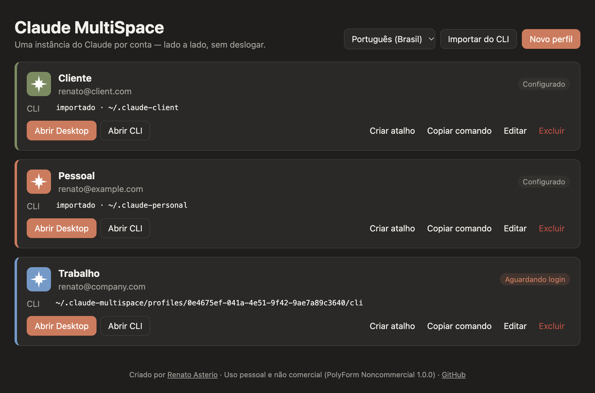
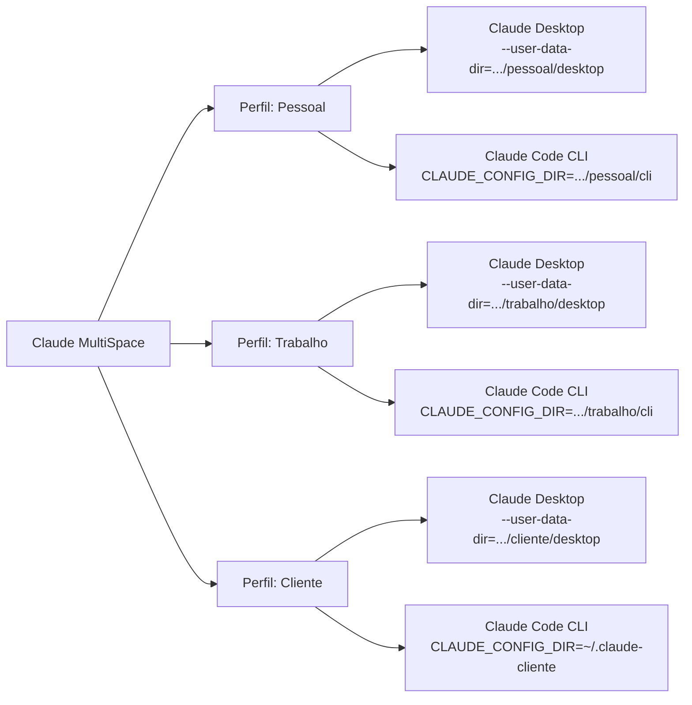
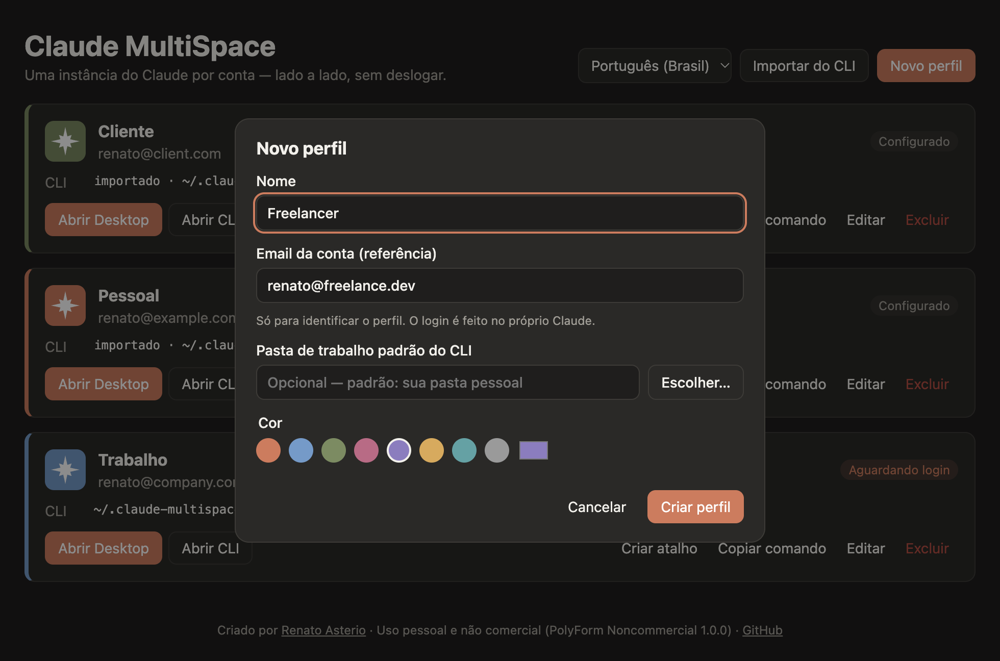
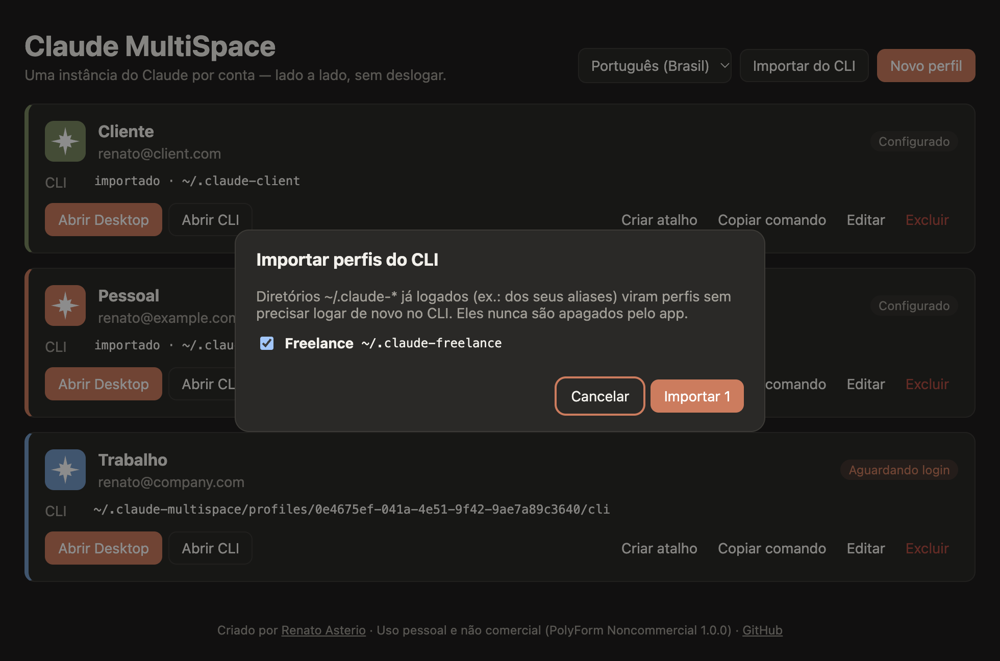

<div align="center">

# Claude MultiSpace

**Use todas as suas contas do Claude ao mesmo tempo, lado a lado, sem precisar deslogar.**

Claude Desktop e Claude Code CLI em instâncias isoladas, uma para cada conta, no macOS e no Windows.

[English](README.md) · **Português (Brasil)** · [Español](README.es.md)

[](LICENSE.md)




</div>

---

## Sumário

- [O problema](#o-problema)
- [A solução](#a-solução)
- [Recursos](#recursos)
- [Como funciona](#como-funciona)
- [Requisitos](#requisitos)
- [Instalação](#instalação)
- [Primeiros passos](#primeiros-passos)
- [Guia de uso](#guia-de-uso)
- [Onde ficam os dados](#onde-ficam-os-dados)
- [Perguntas frequentes](#perguntas-frequentes)
- [Solução de problemas](#solução-de-problemas)
- [Segurança e privacidade](#segurança-e-privacidade)
- [Para desenvolvedores](#para-desenvolvedores)
- [Licença](#licença)
- [Autor e créditos](#autor-e-créditos)

---

## O problema

Quem trabalha com mais de uma conta do Claude (pessoal, empresa, clientes, cada uma com seu próprio plano) esbarra no mesmo limite todos os dias:

- O **Claude Desktop** só fica logado em **uma conta por vez**. Para trocar, você precisa sair e entrar de novo.
- O **Claude Code CLI** usa a mesma configuração global (`~/.claude`) para todos os terminais, então trocar de conta também exige `/logout` e `/login`.
- Não dá para ter **duas janelas do Claude abertas em contas diferentes** trabalhando em projetos diferentes ao mesmo tempo.

Cada troca interrompe o trabalho, derruba a sessão em andamento e consome tempo. Com três contas, isso acontece várias vezes por dia.

## A solução

O **Claude MultiSpace** é um gerenciador de perfis. Cada perfil representa uma conta e tem o seu próprio espaço isolado no disco. Com um clique, ele abre:

- **uma nova janela do Claude Desktop** com a sessão daquele perfil, e
- **um terminal com o Claude Code CLI** já configurado para aquele perfil.

Você faz login **uma única vez por perfil**. A partir daí, cada conta abre já logada, e todas podem ficar abertas ao mesmo tempo.

<div align="center">

| Antes                                    | Com o Claude MultiSpace                                 |
| ---------------------------------------- | ------------------------------------------------------- |
| 1 conta logada por vez                   | Todas as contas abertas em paralelo                     |
| Logout e login a cada troca              | Login uma vez por perfil, para sempre                   |
| `~/.claude` compartilhado entre projetos | Configuração, MCPs e histórico separados por conta      |
| Aliases manuais no `.zshrc`              | Interface gráfica com importação automática dos aliases |

</div>

## Recursos

- **Perfis ilimitados**, cada um com nome, cor, email de referência e pasta de trabalho padrão.
- **Claude Desktop isolado por perfil**: várias janelas abertas lado a lado, cada uma em uma conta.
- **Claude Code CLI isolado por perfil**: abre o terminal já com o `CLAUDE_CONFIG_DIR` certo.
- **Aba Code do Desktop alinhada ao CLI**: o Desktop de cada perfil usa a mesma configuração do CLI daquele perfil.
- **Importação dos seus aliases**: diretórios `~/.claude-*` que já existem viram perfis sem precisar logar de novo.
- **Copiar comando**: gera uma função `claude-<perfil>` para o seu `~/.zshrc` ou `$PROFILE` do PowerShell.
- **Uma janela por perfil**: abrir um perfil que já está aberto traz a janela dele para a frente, em vez de iniciar uma segunda cópia (duas cópias no mesmo perfil poderiam corromper a sessão).
- **Ícones coloridos**: cada perfil tem um ícone próprio na cor dele, nos cards, no menu da barra de menus/bandeja e no atalho.
- **Atalhos por perfil**: um app no Launchpad/Dock (macOS) ou um item no Menu Iniciar (Windows), com o ícone do perfil, que abre direto o Claude Desktop daquele perfil.
- **Status em tempo real**: mostra se o Desktop de cada perfil está aberto, configurado ou aguardando login.
- **Ícone na barra de menus/bandeja** com atalhos para abrir qualquer perfil.
- **Inglês, português (Brasil) e espanhol**, com seletor de idioma no app. Na primeira execução, o app segue o idioma do sistema.
- **macOS e Windows**, com tema claro e escuro automático.
- **Privacidade**: o app nunca lê, copia ou transmite credenciais. O login acontece no próprio Claude.

## Como funciona

O Claude MultiSpace não modifica o Claude. Ele usa dois mecanismos oficiais de isolamento:



| Aplicativo      | Mecanismo                                             | O que fica separado                                                                  |
| --------------- | ----------------------------------------------------- | ------------------------------------------------------------------------------------ |
| Claude Desktop  | Nova instância com `--user-data-dir=<perfil>/desktop` | Sessão de login, cookies, `claude_desktop_config.json`, servidores MCP, preferências |
| Claude Code CLI | Variável `CLAUDE_CONFIG_DIR=<perfil>/cli`             | Login, configurações, histórico, agentes e comandos                                  |

Como cada perfil tem seu próprio diretório, as instâncias não disputam a mesma sessão e podem rodar ao mesmo tempo.

## Requisitos

|                 | macOS                                            | Windows                                                                       |
| --------------- | ------------------------------------------------ | ----------------------------------------------------------------------------- |
| Sistema         | macOS 12 ou superior (Intel ou Apple Silicon)    | Windows 10 ou 11 (x64 ou ARM64)                                               |
| Claude Desktop  | Instalado em `/Applications` ou `~/Applications` | Instalado pelo instalador de [claude.ai/download](https://claude.ai/download) |
| Claude Code CLI | Opcional, necessário para o botão **Abrir CLI**  | Opcional, necessário para o botão **Abrir CLI**                               |
| Terminal        | Terminal.app (nativo)                            | Windows Terminal (recomendado) ou Prompt de Comando                           |

Para instalar o Claude Code CLI:

```bash
curl -fsSL https://claude.ai/install.sh | bash
```

## Instalação

### Opção 1: instalador pronto

1. Acesse a página de [Releases](https://github.com/renatoasterio/claude-multi-space/releases).
2. Baixe o arquivo do seu sistema:
   - **macOS**: `Claude-MultiSpace-<versão>-universal.dmg`
   - **Windows**: `Claude-MultiSpace-Setup-<versão>.exe`
3. Instale normalmente.

> **Primeira abertura.** Os instaladores ainda não têm assinatura digital, então o sistema mostra um aviso:
>
> - **macOS**: clique com o botão direito no app, escolha **Abrir** e confirme.
> - **Windows**: na tela do SmartScreen, clique em **Mais informações** e depois em **Executar assim mesmo**.

### Opção 2: a partir do código-fonte

Rodar o app pelo código-fonte requer [Node.js](https://nodejs.org) 20.19 ou superior. **Gerar os instaladores requer Node.js 22.12 ou superior**: o repositório inclui um `.nvmrc`, então com o [nvm](https://github.com/nvm-sh/nvm) basta rodar `nvm use` antes.

```bash
git clone https://github.com/renatoasterio/claude-multi-space.git
```

```bash
cd claude-multi-space
```

```bash
npm install
```

```bash
npm run dev
```

Para gerar o seu próprio instalador (Node.js 22.12+):

```bash
nvm use
```

```bash
npm run dist:mac
```

```bash
npm run dist:win
```

O instalador é criado na pasta `dist/`. Gere o instalador do Windows em uma máquina Windows.

## Primeiros passos

### 1. Crie um perfil para cada conta

Clique em **Novo perfil**, dê um nome (por exemplo, _Pessoal_, _Trabalho_ ou _Cliente X_), escolha uma cor e, se quiser, informe o email da conta e uma pasta de trabalho padrão.

<div align="center">

</div>

> O email serve apenas para você identificar o perfil. O login de verdade acontece dentro do Claude.

### 2. Faça login no Claude Desktop do perfil

Clique em **Abrir Desktop**. Uma janela nova do Claude Desktop abre na tela de login. Entre com a conta que corresponde a esse perfil.

Pronto: da próxima vez, essa janela já abre logada. Repita o processo para cada perfil e todas as contas poderão ficar abertas ao mesmo tempo.

### 3. Faça login no Claude Code CLI do perfil

Clique em **Abrir CLI**. Um terminal abre na pasta de trabalho do perfil, já executando o `claude`. Na primeira vez, digite `/login` e entre com a mesma conta.

### Já usa aliases com `CLAUDE_CONFIG_DIR`?

Se você já tem algo como isto no seu `~/.zshrc`:

```bash
alias claude-cliente='CLAUDE_CONFIG_DIR=~/.claude-cliente claude'
```

clique em **Importar do CLI**. O app encontra os diretórios `~/.claude-*` existentes e transforma cada um em um perfil, **sem precisar logar de novo no CLI**.

<div align="center">

</div>

## Guia de uso

### Ações de cada perfil

| Ação               | O que faz                                                                                                                                                                                 |
| ------------------ | ----------------------------------------------------------------------------------------------------------------------------------------------------------------------------------------- |
| **Abrir Desktop**  | Abre a instância do Claude Desktop do perfil. Se ela já estiver aberta, o botão vira **Mostrar Desktop** e traz a janela existente para a frente: nunca há mais de uma janela por perfil. |
| **Abrir CLI**      | Abre um terminal na pasta de trabalho do perfil executando `claude`. Ao sair do `claude`, o terminal continua com o perfil ativo.                                                         |
| **Criar atalho**   | Cria um atalho de app com o ícone e a cor do perfil (veja abaixo). Depois de criado, o botão vira **Atualizar atalho**.                                                                   |
| **Copiar comando** | Copia uma função de shell para usar o perfil em qualquer terminal (veja abaixo).                                                                                                          |
| **Editar**         | Altera nome, cor, email e pasta de trabalho. Os dados de login não são afetados.                                                                                                          |
| **Excluir**        | Remove o perfil. Opcionalmente apaga também a sessão e os dados dele.                                                                                                                     |

### Status dos perfis

| Status               | Significado                                                             |
| -------------------- | ----------------------------------------------------------------------- |
| **Aguardando login** | O perfil ainda não foi usado. Abra o Desktop ou o CLI para fazer login. |
| **Configurado**      | O perfil já tem dados de sessão salvos.                                 |
| **Desktop aberto**   | O Claude Desktop deste perfil está em execução agora.                   |

### Usar um perfil em qualquer terminal

O botão **Copiar comando** gera uma função pronta. No macOS (zsh ou bash):

```bash
claude-trabalho() { CLAUDE_CONFIG_DIR='/Users/voce/.claude-multispace/profiles/<id>/cli' '/Users/voce/.local/bin/claude' "$@"; }
```

Cole no seu `~/.zshrc`, abra um novo terminal e use `claude-trabalho` em qualquer pasta. No Windows, o comando gerado é uma função do PowerShell para colar no seu `$PROFILE`.

### Idioma

Use o seletor de idioma no topo da janela para alternar entre **English**, **Português (Brasil)** e **Español**. A escolha vale na hora para a janela, para o menu da barra de menus/bandeja e para as mensagens de erro, e fica salva para as próximas vezes. Na primeira execução, o app segue o idioma do sistema.

### Atalhos na cor do perfil

**Criar atalho** gera um pequeno app com o ícone e a cor do perfil que abre direto o Claude Desktop daquele perfil, sem precisar abrir a janela do Claude MultiSpace antes:

- **macOS**: o atalho é criado em `~/Applications/Claude MultiSpace` e mostrado no Finder. Ele também aparece no Launchpad e no Spotlight; arraste-o para o Dock para tê-lo sempre à mão.
- **Windows**: o atalho é criado no Menu Iniciar, em **Claude MultiSpace**. Clique com o botão direito para fixá-lo na barra de tarefas ou no Iniciar.

Os atalhos seguem a mesma regra de uma janela por perfil: se aquele perfil já estiver aberto, a janela dele vem para a frente. Renomear o perfil ou trocar a cor atualiza o atalho, e excluir o perfil o remove.

> O ícone que aparece no Dock ou na barra de tarefas **enquanto o Claude Desktop está aberto** pertence ao app da Anthropic e não pode ser trocado por outros programas. A cor do perfil aparece no atalho que você clica para abri-lo, no app e na barra de menus/bandeja.

### Barra de menus e bandeja

O ícone do Claude MultiSpace na barra de menus (macOS) ou na bandeja do sistema (Windows) lista todos os perfis com o ícone colorido de cada um e atalhos para abrir o Desktop ou o CLI. Perfis com o Desktop aberto aparecem marcados com `●`.

Fechar a janela principal apenas a esconde. Para encerrar o app, use **Sair** no menu do ícone ou `⌘Q`.

### Excluir um perfil

Ao excluir, você escolhe se quer apagar também a sessão e os dados do perfil. Por segurança:

- Não é possível apagar os dados de um perfil com o Claude Desktop aberto. Feche a janela primeiro.
- Diretórios importados (como `~/.claude-cliente`) **nunca** são apagados. Apenas o perfil sai da lista.

## Onde ficam os dados

Tudo fica na sua máquina, em pastas acessíveis apenas pelo seu usuário (permissão `0700`):

```text
~/.claude-multispace/
├── profiles.json            # nomes, cores e caminhos dos perfis (sem credenciais)
├── settings.json            # preferências do app (idioma)
├── shortcuts.json           # onde o atalho de cada perfil foi criado
├── icons/                   # ícones dos atalhos (Windows)
├── scripts/                 # scripts usados para abrir o CLI no terminal
└── profiles/
    └── <id-do-perfil>/
        ├── desktop/         # dados da instância do Claude Desktop deste perfil
        └── cli/             # CLAUDE_CONFIG_DIR do Claude Code deste perfil
```

No Windows, `~` corresponde a `C:\Users\<seu-usuário>`.

Para fazer backup de todos os perfis, copie a pasta `~/.claude-multispace` com o app e o Claude fechados.

## Perguntas frequentes

<details>
<summary><strong>Isso viola os termos de uso do Claude?</strong></summary>

O Claude MultiSpace apenas organiza contas **que são suas**, usando opções de isolamento suportadas pelo próprio Claude Desktop (`--user-data-dir`) e pelo Claude Code (`CLAUDE_CONFIG_DIR`). Ele não altera o Claude, não contorna limites de uso e não compartilha contas. Continue seguindo os termos de uso da Anthropic para cada conta.
</details>

<details>
<summary><strong>O app tem acesso às minhas senhas ou tokens?</strong></summary>

Não. O login é feito dentro do próprio Claude, e os dados de sessão ficam nas pastas do perfil, gravados pelo Claude. O Claude MultiSpace nunca lê, copia ou envia credenciais, e não faz nenhuma conexão de rede.
</details>

<details>
<summary><strong>Minha instalação normal do Claude é afetada?</strong></summary>

Não. A instância padrão do Claude Desktop e o `~/.claude` continuam funcionando como antes, e podem rodar junto com os perfis.
</details>

<details>
<summary><strong>Meus servidores MCP e configurações aparecem em todos os perfis?</strong></summary>

Não. Cada perfil é independente e começa com as configurações padrão do Claude. Configure os MCPs dentro de cada perfil, ou copie o `claude_desktop_config.json` para a pasta `desktop` do perfil.
</details>

<details>
<summary><strong>Posso usar o mesmo perfil no Desktop e no CLI?</strong></summary>

Sim, esse é o uso recomendado. O Desktop de cada perfil recebe o mesmo `CLAUDE_CONFIG_DIR` do CLI daquele perfil, então a aba Code do Desktop e o terminal ficam na mesma configuração.
</details>

<details>
<summary><strong>Posso abrir o mesmo perfil duas vezes?</strong></summary>

Não, de propósito. O Claude Desktop não se protege contra duas cópias usando a mesma pasta de perfil, o que poderia corromper a sessão. O Claude MultiSpace confere os processos em execução e, se o perfil já estiver aberto, traz a janela dele para a frente, seja pelo botão, pelo menu da bandeja ou por um atalho.
</details>

<details>
<summary><strong>O Claude Desktop continua recebendo atualizações?</strong></summary>

Sim. Todas as instâncias usam o mesmo Claude instalado. Quando ele se atualiza, todos os perfis passam a usar a nova versão.
</details>

## Solução de problemas

| Sintoma                                                        | Causa provável e solução                                                                                                                                                                                               |
| -------------------------------------------------------------- | ---------------------------------------------------------------------------------------------------------------------------------------------------------------------------------------------------------------------- |
| Aviso "Claude Desktop não encontrado"                          | O Claude não está no local padrão. No macOS, mova-o para `/Applications`. No Windows, instale pelo instalador de [claude.ai/download](https://claude.ai/download) (a versão da Microsoft Store ainda não é suportada). |
| Aviso "Claude Code CLI não encontrado"                         | Instale o CLI com `curl -fsSL https://claude.ai/install.sh \| bash` e reabra o app.                                                                                                                                    |
| O botão **Mostrar Desktop** só traz uma janela para a frente   | Aquele perfil já está aberto, e só é permitida uma janela por perfil. É o comportamento esperado.                                                                                                                      |
| O status não atualiza                                          | O status é atualizado quando você volta para a janela do app. Clique nela para forçar a atualização.                                                                                                                   |
| "Feche o Claude Desktop deste perfil antes de apagar os dados" | Feche a janela do Claude daquele perfil e tente excluir de novo.                                                                                                                                                       |
| O macOS diz que o app "não pode ser aberto"                    | Clique com o botão direito no app, escolha **Abrir** e confirme (o instalador ainda não é assinado).                                                                                                                   |

## Segurança e privacidade

- **Sem rede**: o app não faz nenhuma requisição para a internet e não coleta dados de uso.
- **Sem credenciais**: o app nunca lê, copia ou armazena tokens. Eles ficam apenas nos arquivos gravados pelo próprio Claude.
- **Interface isolada**: a interface roda em sandbox, sem acesso ao Node.js, com política de segurança de conteúdo (CSP) restrita e navegação bloqueada.
- **Comunicação validada**: toda chamada da interface para o processo principal tem a origem verificada e os dados validados.
- **Sem injeção de comandos**: programas externos são executados sem shell, e todos os valores usados em scripts passam por funções de escape testadas contra entradas maliciosas.
- **Exclusão segura**: o app só apaga arquivos dentro da própria pasta e se recusa a seguir links simbólicos para fora dela.
- **Binário endurecido**: o pacote final usa Electron Fuses para desativar recursos de depuração e validar a integridade do código.

Encontrou uma vulnerabilidade? Abra uma [issue](https://github.com/renatoasterio/claude-multi-space/issues) sem detalhes sensíveis e peça um canal privado para o relato.

## Para desenvolvedores

### Scripts

| Comando                                 | Descrição                                              |
| --------------------------------------- | ------------------------------------------------------ |
| `npm run dev`                           | Inicia o app com recarregamento automático             |
| `npm test`                              | Executa os testes unitários e de integração (Vitest)   |
| `npm run typecheck`                     | Verifica os tipos do processo principal e da interface |
| `npm run lint`                          | Executa o ESLint                                       |
| `npm run format`                        | Formata o código com o Prettier                        |
| `npm run build`                         | Gera o build de produção em `out/`                     |
| `npm run dist:mac` / `npm run dist:win` | Gera os instaladores em `dist/`                        |

### Arquitetura

O projeto segue Clean Architecture: as dependências sempre apontam para o domínio, e o ESLint impede que as camadas internas importem Electron, Node.js ou infraestrutura.

```text
src/
├── shared/              # contratos IPC, schemas zod, dicionários de idioma e regras compartilhadas
├── main/
│   ├── domain/          # entidade Profile, value objects e erros de domínio (chaves de mensagem, sem texto)
│   ├── application/     # portas (interfaces), serviços e casos de uso
│   ├── infrastructure/  # repositório JSON, disco, launchers por sistema, detecção de processos
│   ├── mappers/         # conversão entre entidade, registro persistido e DTO
│   ├── utils/           # spawn sem shell, escape de shell, fila serial, logger
│   ├── presentation/    # handlers IPC, janela principal, ícone da bandeja
│   └── container.ts     # composition root (injeção de dependências manual)
├── preload/             # ponte mínima e tipada entre a interface e o main
└── renderer/            # interface em React, organizada por feature
tests/
├── unit/                # domínio, casos de uso (com fakes), mappers, utils e i18n
└── integration/         # repositório e workspace usando o sistema de arquivos real
```

### Testando atalhos em desenvolvimento

No macOS, os atalhos abrem links `claude-multispace://`, que o sistema só entrega ao app empacotado (o esquema é declarado no `Info.plist` dele). Para testá-los, gere com `npm run dist:mac` e rode o app de `dist/`.

### Adicionando um idioma

1. Copie `src/shared/i18n/messages/en.ts` para um novo arquivo e traduza todos os valores. O TypeScript impede o build se faltar alguma chave.
2. Registre o idioma em `src/shared/i18n/locales.ts` e no catálogo em `src/shared/i18n/translate.ts`.
3. Rode `npm test`: os testes de i18n conferem se todos os idiomas têm as mesmas chaves e os mesmos parâmetros.

### Stack

[Electron](https://www.electronjs.org) · [React](https://react.dev) · [TypeScript](https://www.typescriptlang.org) · [electron-vite](https://electron-vite.org) · [Zod](https://zod.dev) · [Vitest](https://vitest.dev) · [electron-builder](https://www.electron.build)

### Contribuindo

Contribuições são bem-vindas, dentro dos termos da [licença](#licença):

1. Faça um fork e crie uma branch para a sua alteração.
2. Rode `npm run lint`, `npm run typecheck` e `npm test` antes de abrir o pull request.
3. Descreva o problema resolvido e como você testou, especialmente se a alteração envolver Windows.

## Licença

Este projeto é **gratuito e de código aberto para uso pessoal e não comercial**, distribuído sob a licença [PolyForm Noncommercial 1.0.0](LICENSE.md).

| ✅ Permitido                                                   | ❌ Não permitido                                             |
| -------------------------------------------------------------- | ------------------------------------------------------------ |
| Usar para fins pessoais, estudo, hobby e pesquisa              | Vender o software ou cópias dele                             |
| Estudar e modificar o código                                   | Usar em produtos, serviços ou atividades com fins lucrativos |
| Compartilhar cópias e versões modificadas, sem fins lucrativos | Incluir em ofertas comerciais, pagas ou patrocinadas         |
| Fazer forks, mantendo os créditos ao autor                     | Remover ou alterar os avisos de autoria                      |

Toda cópia, fork ou trabalho derivado deve manter o arquivo [LICENSE.md](LICENSE.md), incluindo as linhas `Required Notice` com o crédito a **Renato Asterio**.

Para uso comercial, entre em contato com o autor.

## Autor e créditos

<div align="center">

Criado e mantido por **[Renato Asterio](https://github.com/renatoasterio)**.

Se o projeto ajudou você, deixe uma ⭐ no repositório.

</div>

---

<sub>O Claude MultiSpace é um projeto independente e não é afiliado, patrocinado ou endossado pela Anthropic. "Claude" e "Claude Code" são marcas da Anthropic, PBC.</sub>
